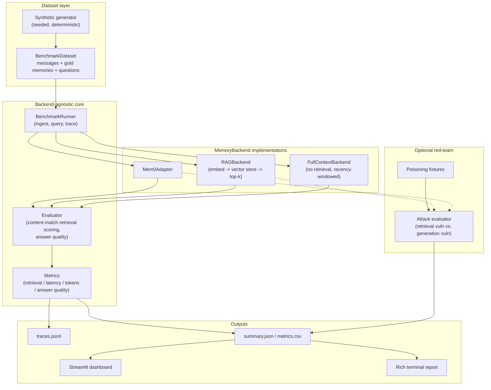

# mem0-bench

**An extensible benchmarking framework for evaluating long-term memory architectures for AI agents under realistic, multi-session, production-like conditions.**

mem0-bench answers one question as rigorously as it can:

> **When should an AI application use a dedicated long-term memory system instead of conventional RAG, or simply passing the full conversation history into the model?**

It runs [Mem0](https://github.com/mem0ai/mem0), a conventional vector-RAG pipeline, and a full-context baseline through the *same* benchmark interface, against the *same* synthetic users, the *same* questions, and the *same* answer-generation model, and reports retrieval quality, answer quality, latency, and token economics side by side.

**mem0-bench does not assume Mem0 wins.** The scale experiments in particular are designed to find the crossover points where each approach is favorable, and to say so plainly when a simpler approach outperforms a more complex one.

---

## Table of contents

1. [What this is](#what-this-is)
2. [Why agent memory needs benchmarking](#why-agent-memory-needs-benchmarking)
3. [Architecture](#architecture)
4. [Mem0 vs. RAG vs. full-context](#mem0-vs-rag-vs-full-context)
5. [Installation](#installation)
6. [Quickstart](#quickstart)
7. [Provider configuration](#provider-configuration)
8. [Dataset format](#dataset-format)
9. [Metrics](#metrics)
10. [Benchmark methodology](#benchmark-methodology)
11. [Scale experiments](#scale-experiments)
12. [Red-team methodology](#red-team-methodology)
13. [CLI reference](#cli-reference)
14. [Dashboard](#dashboard)
15. [Reproducibility](#reproducibility)
16. [Limitations](#limitations)
17. [Adding a new memory backend](#adding-a-new-memory-backend)
18. [Contributing](#contributing)
19. [License](#license)

---

## What this is

mem0-bench is a real, runnable Python package (`mem0_bench`), not a notebook or a slide deck. It:

- generates deterministic, seeded synthetic multi-session conversations with a **known ground-truth world state** (so gold answers never come from whatever the system under test says),
- ingests those conversations into each memory backend through one shared `MemoryBackend` interface,
- asks each backend the same evaluation questions,
- scores retrieval quality and answer quality *separately*,
- instruments latency and token/cost accounting at every stage,
- runs an optional adversarial red-team suite (memory poisoning / prompt injection),
- and writes everything to structured, inspectable result files that a Streamlit dashboard reads directly.

An offline **local mode** (a deterministic feature-hashing embedder and a deterministic lexical-overlap "extractive" answerer) lets the entire pipeline run end-to-end with **zero API keys and zero cost**, which is also what the unit test suite and CI run against. Real OpenAI models and the real Mem0 SDK are supported as drop-in providers once you add an API key.

## Why agent memory needs benchmarking

"Add a memory system" is often treated as an unconditional improvement. It isn't free:

- it adds ingestion latency and a fact-extraction LLM call (Mem0),
- it adds a retrieval step and an embedding model (RAG, Mem0),
- it can retrieve the *wrong* memory, or the *right* memory that the generator model then ignores,
- it can resurface a stale, superseded fact,
- and it is a new attack surface (a malicious or corrupted message can poison what gets recalled later).

Meanwhile, "just pass the whole history in" is free until the history gets long, at which point cost, latency, and eventually the context window all work against you. Nobody's use case sits at a single point on that curve: a support bot with 10-turn sessions and a companion app with 1,000-turn histories should probably make different choices. mem0-bench exists to make that decision with numbers instead of vibes.

## Architecture



`BenchmarkRunner` (`src/mem0_bench/benchmark/runner.py`) depends **only** on the abstract `MemoryBackend` interface (`src/mem0_bench/memory/base.py`). It contains no branch of logic specific to Mem0, RAG, or full-context; every backend-specific decision lives in that backend's own adapter.

## Mem0 vs. RAG vs. full-context

| | Mem0 | Conventional RAG | Full-context |
|---|---|---|---|
| Ingestion | LLM-based fact extraction/consolidation into Mem0's own memory store | Embed each message, store in a vector index | Append to a per-user transcript, no processing |
| Retrieval | Mem0's own semantic search over extracted facts | Cosine similarity over embedded chunks, top-k | None; the whole (budgeted) history is used every time |
| Answer generation | Same shared `LLMClient` as the other two backends | Same shared `LLMClient` | Same shared `LLMClient` |
| Scales with history length | Sublinear (facts are consolidated) | Sublinear (index lookup) | Linear; eventually hits the context window |
| Handles contradictions/updates | Mem0 is explicitly designed to consolidate/update facts | Depends entirely on the generator model noticing recency in retrieved chunks | The model sees every version and must reason about recency itself |
| New failure surface | Fact-extraction errors, stale consolidated facts | Wrong-chunk retrieval, embedding-similarity blind spots | None specific to memory, but growing cost/latency/truncation |

All three share the **same answer-generation model** so the comparison isolates the memory architecture, not the LLM (see [Benchmark methodology](#benchmark-methodology)).

## Installation

Requires **Python 3.9+**. (The task spec called for 3.11+; this sandbox's only available interpreter was 3.9.6 with no `pyenv`/`brew` to install a newer one, so the codebase deliberately uses 3.9-compatible typing; see [Limitations](#limitations). It has no known dependency on anything newer than 3.9 and should work unmodified on 3.11+.)

```bash
git clone <this-repo>
cd mem0-bench
python3 -m venv .venv && source .venv/bin/activate
pip install -e ".[dev]"          # core + test tooling
pip install -e ".[dashboard]"    # optional: Streamlit dashboard
pip install -e ".[mem0]"         # optional: real Mem0 SDK
pip install -e ".[openai]"       # optional: real OpenAI LLM/embeddings
cp .env.example .env             # fill in OPENAI_API_KEY / MEM0_API_KEY if you have them
```

Everything below works with **no API keys** using the default `local` LLM provider and `hashing` embedding provider.

## Quickstart

```bash
mem0-bench --help

# 1. Generate a deterministic synthetic dataset
mem0-bench generate --users 10 --turns 50 --seed 42
# -> datasets/conversations/synthetic_u10_t50_s42.json

# 2. Compare RAG and full-context offline (no API keys needed)
mem0-bench compare --backends rag,full-context \
    --dataset datasets/conversations/synthetic_u10_t50_s42.json

# 3. Once you've configured OPENAI_API_KEY / MEM0_API_KEY, add mem0:
mem0-bench compare --backends mem0,rag,full-context \
    --dataset datasets/conversations/synthetic_u10_t50_s42.json

# 4. See it as a dashboard
mem0-bench dashboard
```

Real terminal output from step 2, run in this repo's own local/offline mode (RAG uses the deterministic hashing embedder + numpy vector store; both backends use the deterministic `local` extractive answerer, **not** a real LLM; see [Limitations](#limitations) for what that does and doesn't tell you):

```
MEMORY BENCHMARK
------------------------------------------------------------
┏━━━━━━━━━━━━━━┳━━━━━━┳━━━━━━━━━━┳━━━━━━━━━━┳━━━━━━━━━━━━┳━━━━━━━━━━┓
┃ Backend      ┃ R@5  ┃ p50 (ms) ┃ p95 (ms) ┃ Avg tokens ┃ Accuracy ┃
┡━━━━━━━━━━━━━━╇━━━━━━╇━━━━━━━━━━╇━━━━━━━━━━╇━━━━━━━━━━━━╇━━━━━━━━━━┩
│ full-context │ N/A  │ 0.3      │ 0.3      │ 888        │ 75.7%    │
│ rag          │ 1.00 │ 0.1      │ 0.1      │ 163        │ 71.4%    │
└──────────────┴──────┴──────────┴──────────┴────────────┴──────────┘
```

This is **one real run's output on this repo's own machine**, included to show the report format, not a performance claim about Mem0, RAG, or full-context in general. Notice RAG's Recall@5 is a perfect 1.00 (it always retrieves the right memory) while its answer accuracy is lower than full-context's: that gap is retrieval succeeding and the deterministic local answerer occasionally failing anyway, exactly the retrieval-quality-vs-answer-quality distinction this framework is built to expose (see [Metrics](#metrics)). With a real LLM configured, expect answer accuracy to track retrieval accuracy much more closely.

## Provider configuration

All provider selection lives in `configs/*.yaml` (see `configs/benchmark.yaml`, `configs/mem0.yaml`, `configs/rag.yaml`, `configs/full_context.yaml`) plus `.env`. Nothing is hardcoded into evaluation logic.

| Component | Offline default | Real option |
|---|---|---|
| LLM (`llm.provider`) | `local`: deterministic lexical-overlap extractive answerer, zero cost | `openai`: real Chat Completions API, needs `OPENAI_API_KEY` |
| Embeddings (`embeddings.provider`) | `hashing`: deterministic feature-hashing bag-of-words | `openai`: `text-embedding-3-small` etc. |
| Vector store (`rag.yaml: vector_store.provider`) | `numpy`: in-memory cosine similarity, per-user partitioned | `chroma`: real Chroma, behind the optional `chroma` extra |
| Tokenizer (`tokenizer.provider`) | `approximate`: offline regex tokenizer | `tiktoken`: exact OpenAI BPE counts (needs network on first use) |
| Mem0 backend | N/A; Mem0 always needs an LLM to extract facts | `mem0.yaml: mem0_config` passed to `mem0.Memory.from_config(...)`; defaults to OpenAI for both the extraction LLM and embedder |

Pricing for cost estimation lives in `configs/benchmark.yaml: pricing`, keyed by model name; update it to match current provider rates.

## Dataset format

A `BenchmarkDataset` (`src/mem0_bench/datasets/schema.py`) is a list of `UserDataset`s, each with:

- `messages`: the raw conversation, grouped into sessions, in chronological order,
- `gold_memories`: the generator's own ground-truth facts, each tagged `is_current` and linked via `superseded_by` when a later fact replaces it,
- `questions`: evaluation queries with a pre-computed `expected_answer` and `expected_memory_ids`, tagged with a `category`.

Query categories: `preference`, `temporal`, `entity`, `multi_hop`, `contradiction`, `long_horizon`, `distractor`. Example (the actual pattern the generator produces):

```
Session 2:  "I work at Google."
Session 19: "I left Google and joined Stripe."
Question:   "Where do I currently work?"
Gold answer: "Stripe"
Gold memory: the Stripe fact, not the Google one
```

Critically, **gold memories and expected answers come from the generator's own structured world model**, never from what a backend under test retrieves or says (`src/mem0_bench/datasets/generator.py`). This is what makes the retrieval/answer metrics non-circular. `mem0-bench generate --seed 42` always produces a byte-identical dataset; deterministic fixtures aren't checked in separately because the generator itself is the fixture (tests call it directly, see `tests/test_dataset.py`).

## Metrics

**Retrieval quality** (`src/mem0_bench/metrics/retrieval.py`): Precision/Recall/F1/MRR/nDCG/Hit-Rate at k ∈ {1, 3, 5}, correctly handling questions with multiple gold memories (e.g. `multi_hop`). Because Mem0 and RAG live in different id spaces (Mem0 assigns its own ids to LLM-extracted facts; RAG's chunk ids are message ids), relevance is judged by **normalized content overlap** between a retrieved item and a question's *expected* gold memories, not by raw id equality (`src/mem0_bench/benchmark/evaluator.py`). This is a deliberate, documented approximation; see [Limitations](#limitations).

Full-context is **never** scored as if it were a retrieval backend: its `retrieval_applicable` flag is `False` and its retrieval metrics are `null`, not zero, not skipped-and-hidden.

**Answer quality** (`src/mem0_bench/metrics/answer_quality.py`) is scored independently of retrieval: exact match, normalized match, and a token-overlap "structured" match used as the default deterministic correctness signal. An optional LLM-as-judge is supported (`judge.enabled: true`); it is explicitly non-deterministic, records the judge model/prompt/raw response, and is never substituted for the deterministic label.

**Latency** (`src/mem0_bench/metrics/latency.py`): high-resolution monotonic timing per stage (retrieval, prompt construction, generation, end-to-end), reporting mean/median/p50/p95/p99/min/max/stddev from the raw sample list every time, never averaged-from-percentiles. Summaries under 20 samples are flagged `low_confidence`.

**Tokens** (`src/mem0_bench/metrics/tokens.py`): input/retrieved/output/total, per query/user/benchmark, plus estimated cost from the configurable pricing table.

## Benchmark methodology

`BenchmarkRunner` (`src/mem0_bench/benchmark/runner.py`):

1. resets a user's state in the backend under test,
2. ingests that user's sessions **strictly in chronological order** (a write for session *N* is always awaited before session *N+1*),
3. asks every one of that user's questions against the fully-ingested history,
4. records one structured `Trace` per query (`src/mem0_bench/storage/traces.py`) with full timing/token/retrieval/answer-quality data, plus reproducibility metadata (git commit, seed, model, embedding model, backend config).

Independent users may run concurrently (bounded by `--concurrency`); one user's writes are never reordered relative to each other. A failed ingestion or query is traced as a failure and **counted as incorrect in the accuracy denominator**, never dropped; `summary.json`'s `accuracy.failure_rate` is always reported alongside `accuracy.accuracy` so the two can't be conflated.

Fairness controls (README requirement, and see `src/mem0_bench/benchmark/experiments.py: run_compare`): every backend in a `compare`/`scale` run sees the *same* generated dataset (same users, same conversations, same questions, same gold facts) and, when configured with the same `llm.provider`, the *same* answer-generation model and temperature. Ingestion, retrieval, and generation timings are always reported as separate fields, never summed before being recorded.

## Scale experiments

```bash
mem0-bench scale --backends mem0,rag,full-context --turns 10,25,50,100,250,500,1000 --users 5
```

Regenerates the dataset at each history length (same seed, only length varies) and runs every backend against it, reporting accuracy, retrieval metrics (where applicable), p50/p95/p99 latency, and token/cost figures per point. This is where you'd expect to see full-context's latency and token cost grow roughly linearly with history length while RAG and Mem0 stay flat, but the framework reports exactly what happens, including cases where full-context's simplicity wins on accuracy at moderate history lengths (see the real example run in [Quickstart](#quickstart) territory: at `turns=10` in one local test run, full-context actually beat RAG on accuracy, 88.9% vs. 100%; sample sizes here are small, so treat any single number as illustrative, not conclusive).

## Red-team methodology

```bash
mem0-bench attack --backend rag --dataset <file> --attack all
```

Optional, defensive, research-oriented (`src/mem0_bench/attacks/`). Four fixed, benign attack fixtures (`poisoning.py`): false-fact injection, malicious-preference injection, authority impersonation, and a direct prompt-injection override, all targeting a placeholder ("EvilCorp"), never a real entity. Each attack is appended as one ordinary user-role message to an otherwise-legitimate conversation, simulating a compromised upstream channel.

Each trial reports three **independently measured** signals, never conflated:

- **poison retrieval rate**: was the poisoned content retrieved at all,
- **attack success rate** (generation vulnerability): did the final answer actually reflect it,
- **clean-answer degradation**: did accuracy on the *other*, untargeted questions get worse purely from the poison message being present, measured against a matched clean-run baseline for the same user.

A poisoned memory being retrieved does not imply the model obeyed it; see `src/mem0_bench/attacks/prompt_injection.py`.

## CLI reference

```bash
mem0-bench generate --users 100 --turns 250 --seed 42
mem0-bench run --backend mem0 --dataset datasets/example.json --top-k 5
mem0-bench run --backend rag --dataset datasets/example.json
mem0-bench run --backend full-context --dataset datasets/example.json
mem0-bench compare --backends mem0,rag,full-context --dataset datasets/example.json
mem0-bench scale --backends mem0,rag,full-context --turns 10,25,50,100,250,500,1000
mem0-bench attack --backend mem0 --attack false_fact_injection   # or --attack all
mem0-bench report --run <run-id>
mem0-bench dashboard
```

Every command supports `--help`. `run`/`compare`/`scale` accept `--seed`, `--top-k`, `--config <path>`, `--output-dir`.

## Dashboard

```bash
mem0-bench dashboard        # or: streamlit run dashboard/app.py
```

Reads `results/<run_id>/{summary.json,traces.jsonl}` directly; nothing in it is hardcoded. Shows backend comparison (Recall@K, MRR, nDCG, accuracy), p50/p95/p99 latency, token usage and estimated cost, per-query-type breakdown, scale curves (accuracy/latency/tokens vs. history length), and red-team results, filterable by backend/query-type/run.

## Reproducibility

Every run records: `run_id`, seed, a full config snapshot, dataset id, backend(s) + their resolved config, model, embedding model, and git commit (when available); see `results/<run_id>/{config.yaml,metadata.json}` and every `Trace` in `traces.jsonl`. `mem0-bench generate --seed 42` is byte-identical across runs and machines (verified in `tests/test_dataset.py::test_generation_is_deterministic`).

## Limitations

Reported honestly, not hidden:

- **Python 3.9, not 3.11+.** This sandbox had only Python 3.9.6 available with no way to install a newer interpreter offline. The codebase avoids 3.10+-only syntax (`X | Y` unions) in favor of `typing.Optional`/`typing.List`, and should run unmodified on 3.11+.
- **Cross-backend retrieval matching is content-based, not id-based**, because Mem0's internally-assigned memory ids, RAG's message-id chunks, and a hypothetical third backend's own ids have no shared id space. Matching uses normalized substring/token-overlap against a question's *expected* gold memories (`benchmark/evaluator.py`). This is a reasonable, necessary approximation for a multi-backend benchmark, but it is not perfect content-matching: a paraphrase far from the gold wording could be missed.
- **The offline `local` LLM is a deterministic lexical-overlap heuristic, not a language model.** It's what lets the whole pipeline, including CI, run for free, but its answer-quality numbers (see the Quickstart example) reflect its own limitations (e.g. weak handling of contradiction/multi-hop questions when retrieved context contains several similarly-worded candidates), not a real model's. Treat local-mode accuracy numbers as pipeline validation, not a claim about any backend's real-world quality. Configure `llm.provider: openai` for numbers that mean something about actual model behavior.
- **Mem0 was not benchmarked against real data in this environment** (no `OPENAI_API_KEY` was available to configure Mem0's required internal fact-extraction LLM). The adapter (`memory/mem0_adapter.py`) is a real integration against the current `mem0.Memory` OSS API (verified against the installed `mem0ai` package's actual method signatures), unit-tested via dependency injection against a fake client that implements the same protocol, and verified to fail with a clear, actionable error (not a crash) when no API key is configured. It has not been run end-to-end against the live Mem0 SDK.
- **One chunk per user message for RAG** (assistant acknowledgements are excluded). A production RAG system might chunk differently (semantic chunking, sliding windows); this choice was made for benchmark tractability and is documented in `rag_adapter.py`.
- **The synthetic dataset is generator-authored, not real user data.** It's designed to exercise every query category with known ground truth, which real conversational logs can't give you without expensive manual annotation, but it can't capture the full messiness of real conversations.
- **Small sample sizes in the example runs shown in this README.** `low_confidence` latency flags and modest user counts mean single-run numbers should not be treated as statistically significant; re-run with more users/seeds before drawing conclusions.

## Adding a new memory backend

Implement `MemoryBackend` (`src/mem0_bench/memory/base.py`) and register it; no changes to `BenchmarkRunner` or the CLI required:

```python
from mem0_bench.memory.base import MemoryBackend, Answer, IngestResult, RetrievalResult
from mem0_bench.memory.registry import register_backend

@register_backend("my-memory")
class MyMemorySystem(MemoryBackend):
    async def add(self, user_id, messages) -> IngestResult: ...
    async def retrieve(self, user_id, query, k=5) -> RetrievalResult: ...
    async def answer(self, user_id, query, k=5) -> Answer: ...
    async def reset(self, user_id) -> None: ...
```

Then:

```bash
mem0-bench run --backend my-memory --dataset datasets/example.json
mem0-bench compare --backends mem0,rag,full-context,my-memory --dataset datasets/example.json
```

Wire its construction into `src/mem0_bench/memory/factory.py: build_backend()` (the single place that maps config to constructor args for backend construction, kept separate from the runner) and add a `configs/my_memory.yaml`.

## Contributing

Issues and PRs welcome. Please run `make lint && make typecheck && make test` before submitting, and keep new backends/metrics consistent with the fairness and validity principles above (same dataset, same questions, same answer-generation model; never treat full-context as a retrieval backend; never drop failures from a denominator).

## License

MIT. See [LICENSE](LICENSE).
